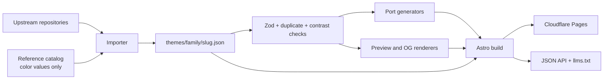

# Terminal Themes — Implementation Plan

Status: proposed. Vocabulary lives in `CONTEXT.md`; decisions live in `docs/adr/`.

## 1. Product

A static, bilingual catalog of terminal color schemes. Every theme is stored once as palette data, then rendered into previews and into configuration files for six targets. The site is generic by design: the Herdr app is the first-class target, not the product boundary.

**Goals**

- Browse, search, compare, and copy any catalog theme.
- Export a theme for the Herdr app, Ghostty, Alacritty, Kitty, iTerm2, and Windows Terminal.
- Edit any palette in the browser, preview it live, and export without a server.
- Accept new themes through GitHub pull requests with automated validation.
- Rank for theme, target, and "how to theme X" queries in English and Chinese.
- Be quotable and machine-readable for generative search engines.

**Non-goals**

- Accounts, votes, comments, or server-side storage.
- Per-target-by-theme landing pages, hex-value pages, or auto-generated comparison pages.
- Redistributing upstream theme files, screenshots, or descriptions.
- Image-to-palette extraction (candidate for a later phase).
- Targets beyond the six listed above (candidate for a later phase).

## 2. Decisions

| # | Decision | Record |
|---|---|---|
| 1 | Upstream-first data; the reference catalog supplies color values only, never images or copy | `docs/adr/0001-theme-data-sourcing.md` |
| 2 | Static-only site; the editor runs in the browser and shares the build's port generator | `docs/adr/0002-static-only-site.md` |
| 3 | English canonical at `/`, full Chinese mirror at `/zh/`, English slugs in both | `docs/adr/0003-bilingual-url-policy.md` |
| 4 | Index only core page types; no combinatorial pages | `docs/adr/0004-core-index-taxonomy.md` |
| 5 | Herdr exports target the Herdr app's JSON theme files; Herdr TUI is out of scope | this plan, §7 |
| 6 | Previews are generated from palette data; real Herdr app captures calibrate, not mass-produce | this plan, §8 |
| 7 | Contributions are editor-generated pull requests | this plan, §10 |
| 8 | Canonical host `terminalthemes.iwwi.app`; `themes.iwwi.app` 301s to it | this plan, §14 |
| 9 | Visual language: terminal-native editorial | this plan, §13 |

## 3. Domain model

- **Theme** — one catalog entry: a named palette plus provenance and metadata.
- **Family** — a group of themes from one upstream project.
- **Palette** — 16 ANSI colors plus background, foreground, cursor, and selection colors.
- **Target** — an application with its own configuration format.
- **Port** — the generated configuration artifact for one target.
- **Source record** — upstream repository, reference page, author, license.
- **Preview** — a generated visual of a theme applied to a target's chrome.
- **Editor** — the browser-side palette editor.

The atomic unit is the theme, not the target. A target never owns palette data; it owns a serializer. This keeps the catalog additive: adding a seventh target adds one serializer and one hub page, not a new data source.

## 4. Information architecture

```
/                                  EN home
/zh/                               ZH home
/themes/                           catalog
/themes/{family}/                  family hub
/themes/{family}/{slug}/           theme page
/herdr-app/                        target hub
/ghostty/
/alacritty/
/kitty/
/iterm2/
/windows-terminal/
/guides/{slug}/                    tutorials
/editor/                           palette editor
/contribute/                       contribution guide
/about/  /license/  /privacy/  /changelog/
/search/                           noindex
/ports/{target}/{family}-{slug}.{ext}   noindex, disallowed
/themes.json                       catalog JSON
/themes/{family}/{slug}/theme.json per-theme JSON
/llms.txt  /llms-full.txt
/sitemap-index.xml  /robots.txt  /feed.xml
```

Chinese routes mirror these under `/zh/`. Slugs are English in both locales.

Catalog size at launch: 36 families, about 110 themes (80 variant links visible on the reference index plus collapsed groups), 6 target hubs, 9 guides, and the editor — roughly 340 indexable pages across two locales.

## 5. Data model

Each theme is one JSON file at `themes/{family}/{slug}.json`. The file contains facts and provenance, never derived values.

```ts
type Hex = `#${string}`;

type AnsiName =
  | "black" | "red" | "green" | "yellow"
  | "blue" | "magenta" | "cyan" | "white"
  | "brightBlack" | "brightRed" | "brightGreen" | "brightYellow"
  | "brightBlue" | "brightMagenta" | "brightCyan" | "brightWhite";

interface Theme {
  schemaVersion: 1;
  id: `${string}/${string}`;          // "catppuccin/mocha"
  family: string;                     // "catppuccin"
  slug: string;                       // "mocha"
  name: string;                       // "Catppuccin Mocha"
  appearance: "dark" | "light";
  palette: {
    background: Hex;
    foreground: Hex;
    cursor: Hex;                      // defaults to foreground
    cursorText: Hex;                  // defaults to background
    selectionBackground: Hex;         // defaults to bright black
    selectionForeground: Hex;         // defaults to foreground
    ansi: Record<AnsiName, Hex>;
  };
  source: {
    upstream?: string;                // repository or canonical file
    reference?: string;               // reference page used for cross-check
    author: string;
    license: string;                  // SPDX id or "unknown"
    licenseUrl?: string;
  };
  description: { en: string; zh?: string };
  tags: string[];                     // "dark", "pastel", "high-contrast"
  meta: { addedAt: string; updatedAt: string };
}
```

Rules:

- Derived values — contrast ratios, OKLCH coordinates, hue distance, ports, previews — are computed at build time and never stored.
- Optional colors resolve through documented fallbacks, not `undefined`.
- `id`, `family`, and `slug` are immutable after publication. Renames go through `redirects.json` and a 301.
- A `zh` description is required for a Chinese page to exist; otherwise the Chinese route is omitted and the English page is linked.
- `theme.json` is the same document, served with `Content-Type: application/json`.

## 6. Import and provenance



The importer is a CLI with a manifest (`scripts/import/sources.yml`) mapping every family and theme to an upstream URL and parser.

- Parsers: iTerm2 plist, Ghostty config, Alacritty TOML, Kitty config, canonical JSON.
- The reference catalog's HTML payload supplies the theme list and background/accent metadata. When upstream data is missing, its palette SVG is fetched and parsed in memory for the 16 ANSI values. SVGs are never stored, committed, or served.
- Bright ANSI colors are the usual source of drift: some catalogs synthesize them. The importer prefers upstream values and records any divergence in the import report.
- Every record must resolve at least one source URL (upstream or reference), an author, and a license. `unknown` is allowed with a source link.
- Duplicate detection compares the 22 colors in OKLab; ΔE00 < 1 is rejected.
- The import report (`docs/import-report.md`) lists source, license, and divergences for review.

## 7. Ports

### 7.1 Targets

| Target | File | Format |
|---|---|---|
| Herdr app | `.json` | theme file with base palette and optional `colors` overrides |
| Ghostty | `.conf` | `background`, `foreground`, `palette = N=#...` |
| Alacritty | `.toml` | `[colors.primary]`, `[colors.normal]`, `[colors.bright]`, cursor, selection |
| Kitty | `.conf` | `color0`–`color15`, `background`, `foreground`, `cursor`, selection |
| iTerm2 | `.itermcolors` | XML plist with sRGB components |
| Windows Terminal | `.json` | scheme object with `black` through `brightWhite` |

Each serializer is a pure function of `Theme`, exported from `src/lib/ports/`, used by both the build and the editor. Golden-file tests pin the output.

### 7.2 Herdr app mapping

The Herdr app reads one JSON file per theme from `~/.config/herdr-app/themes/<name>.json`. The file has five base fields and an optional `colors` block; the app derives panel colors from the base and applies `colors` overrides. The file stem is the theme name shown in Settings → Theme.

```json
{
  "background": "#1e1e2e",
  "foreground": "#cdd6f4",
  "selection": "#585b70",
  "cursor": "#cdd6f4",
  "ansi": [
    "#45475a", "#f38ba8", "#a6e3a1", "#f9e2af",
    "#89b4fa", "#f5c2e7", "#94e2d5", "#a6adc8",
    "#585b70", "#f37799", "#89d88b", "#ebd391",
    "#74a8fc", "#f2aede", "#6bd7ca", "#bac2de"
  ]
}
```

That minimal file is valid and idiomatic. The exporter also emits the full `colors` block so the generated preview and the app agree, and so the UI does not depend on an undocumented derivation:

| App token | Source | Guard |
|---|---|---|
| `canvas` | `shade(bg, -4%)` dark / `+4%` light | — |
| `chrome` | `mix(bg, fg, 3%)` | — |
| `surface` | `mix(bg, fg, 6%)` | — |
| `popover` | `mix(bg, fg, 9%)` | — |
| `raised` | `mix(bg, fg, 11%)` | — |
| `hover` | `mix(bg, fg, 14%)` | — |
| `selected` | `mix(bg, fg, 18%)` | — |
| `border` | `mix(bg, fg, 16%)` | — |
| `input` | `mix(bg, fg, 20%)` | — |
| `foreground` | `foreground` | report ratio; never altered |
| `muted` | `mix(fg, bg, 30%)` | ≥ 3:1 vs `surface`, else `mix(fg, bg, 20%)` |
| `dim` | `mix(fg, bg, 45%)` | ≥ 2.5:1 vs `surface`, else `mix(fg, bg, 35%)` |
| `accent` | `pick(blue, brightBlue)` | ≥ 3:1 vs `surface`; else magenta |
| `accent_foreground` | black or white, higher contrast against `accent` | ≥ 4.5:1 |
| `solid` | `accent` darkened 8% in OKLCH | — |
| `solid_foreground` | same contrast choice as `accent_foreground` | ≥ 4.5:1 |
| `selection` | `selection` | — |
| `working` | `pick(yellow, brightYellow)` | ≥ 3:1 |
| `blocked` | `pick(red, brightRed)` | ≥ 3:1 |
| `done` | `pick(green, brightGreen)` | ≥ 3:1 |
| `idle` | `muted` | — |
| `unknown` | `dim` | — |

`pick(normal, bright)` prefers the normal ANSI color when it clears the guard and falls back to the bright variant. Mixing happens in OKLCH and is clamped to sRGB; the same functions run in Node and the browser, so an editor export is byte-identical to the build output. If a source theme has no selection color, derive it from `ansi.brightBlack`; if it has no cursor, derive it from `foreground`.

Install guide: save the file as `~/.config/herdr-app/themes/<name>.json`, then choose it in Settings → Theme. To make it the default, set `theme` in `~/.config/herdr-app/settings.json`:

```json
{ "theme": { "light": "<light-name>", "dark": "<dark-name>" } }
```

A theme file named like a layout (`win98.json`) belongs to that layout and is offered only there; catalog themes avoid layout names.

### 7.3 Port distribution

Build output at `/ports/{target}/{family}-{slug}.{ext}`, served with `Content-Disposition: inline` and `X-Robots-Tag: noindex`. `robots.txt` disallows `/ports/`; theme pages remain the canonical surface. Generated ports are published for every theme; upstream files are never mirrored.

## 8. Previews

Every theme gets a generated preview; five representative themes also get a manual macOS capture from the running Herdr app for calibration.

**Generated preview** (`scripts/preview/`)

- 1600×1000 logical canvas, 2× raster for OG.
- Herdr app window: title bar, left sidebar with spaces and agent rows (status dots), tab bar, pane grid with borders, status bar. Chrome is driven by the 22 app tokens; terminal panes use ANSI 0–15.
- Fixed content: `git status`, a diff, a prompt, `ls --color`; no timestamps or randomness.
- Font: JetBrains Mono 14/1.4. All text ASCII; no CJK in previews.
- Card variant 800×500 for grids; OG variant 1200×630 per locale.

**Real capture** (`scripts/capture-herdr-app.ts`)

- Uses the installed Herdr app on macOS with a fixture layout in `~/.config/herdr-app/layouts/` and the generated theme file in `~/.config/herdr-app/themes/`.
- Captures the window with `screencapture -l <window-id>`; this is a local, permissioned step, not CI.
- Samples known token regions (sidebar, active row, border, accent, terminal background) and compares them with generated values in CIELAB; flags ΔE00 > 2.
- Stores captures and calibration JSON under `docs/calibration/`; re-runs when the app or its token set changes.

## 9. Editor

Route: `/editor/` and `/zh/editor/`. Loaded as a lazy island; theme pages never load it.

- **State**: 22 colors in the URL fragment, deflated and base64url-encoded; version byte for migrations. No server, no account.
- **Inputs**: start from any catalog theme, blank, or pasted hex list; hex/RGB fields and native color pickers; per-token reset.
- **Checks**: WCAG ratios for foreground/background and each ANSI color; warnings when a derived Herdr app token fails its guard; no moralizing badges.
- **Preview**: terminal mock and Herdr app mock side by side; target tabs for all six ports.
- **Export**: copy or download all six ports plus canonical JSON; build output and editor output share the same serializer.
- **Submit**: copy the JSON, then open the repository's new-file page with the target path prefilled. GitHub's `value` prefill is unreliable, so the flow is copy + paste; the guide says so.
- **Persistence**: last five palettes in `localStorage`; no sync.

## 10. Contribution and CI

A contribution is one JSON file under `themes/{family}/{slug}.json` plus a `zh` description when available.

CI on every PR:

1. Zod schema validation and path/slug consistency.
2. 22 valid hex colors; optional colors resolved by fallback rules.
3. License present; `unknown` is allowed with a source link.
4. OKLab duplicate check (ΔE00 < 1 fails).
5. Contrast report generated; derived-token guards enforced.
6. All six serializers produce golden output.
7. Preview and OG render without errors.
8. Internal link check and a Lighthouse run on representative pages.
9. Build succeeds; Cloudflare Pages preview deploys.

PR template asks for upstream URL, author, license, and a screenshot-free description. Reviewers check attribution, naming, and Chinese copy. `CONTRIBUTING.md` documents the schema, the editor path, and the review checklist.

## 11. SEO

**Page types and intent**

| Page | Intent | Title pattern |
|---|---|---|
| Theme | `{theme} terminal theme`, `{theme} hex codes` | `{Name} — Terminal Color Scheme for Herdr App, Ghostty, Alacritty` |
| Family | `{family} terminal themes` | `{Family} Terminal Themes — All Variants` |
| Target hub | `herdr app themes`, `herdr themes`, `ghostty themes` | `Herdr App Themes — {N} Color Schemes for Herdr` |
| Guide | `how to theme herdr`, `iterm2 color schemes` | `How to Theme the Herdr App — Complete Guide` |
| Editor | `terminal theme editor`, `herdr theme generator` | `Terminal Theme Editor — Edit, Preview, Export` |

**Rules**

- One canonical URL per theme; no target-by-theme duplicates. Target sections live on the theme page with anchors.
- Every theme page carries unique data: palette table, contrast ratios, similar themes with ΔE, six ports, provenance.
- Metadata is generated from facts, not boilerplate: background hex, body contrast, appearance, targets.
- Internal links: theme ↔ family ↔ target hub; theme → similar themes; guide → relevant themes and targets; breadcrumbs everywhere.
- `hreflang` (`en`, `zh`, `x-default`) is reciprocal; each locale self-canonicals.
- Sitemaps split by locale with `lastmod` from `meta.updatedAt`; `robots.txt` disallows `/ports/` and `/search/`.
- Search is Pagefind; `/search/` is `noindex`.
- Performance budget: a single inline script under 3 KB for copy and site appearance; no framework JS on theme, family, or target pages; fonts subset and preloaded; previews sized and lazy below the fold; LCP < 1.5 s on mobile, CLS 0.
- Accessibility: WCAG AA for site UI, keyboard navigation, visible focus, reduced-motion support, table semantics.

**Keyword map**

English: `herdr app themes`, `herdr themes`, `herdr app color scheme`, `herdr color scheme`, `ghostty themes`, `alacritty color schemes`, `kitty themes`, `iterm2 color schemes`, `windows terminal themes`, `terminal theme editor`, `{theme} terminal theme`, `{theme} hex codes`.

Chinese: `终端主题`, `终端配色方案`, `Herdr 主题`, `Ghostty 主题`, `iTerm2 配色`, `Windows Terminal 主题`, `终端配色编辑器`.

**Guides**

1. How to theme the Herdr app
2. Herdr app theme tokens explained
3. How to install a Ghostty theme
4. Alacritty color schemes
5. Kitty themes
6. iTerm2 color schemes
7. Windows Terminal color schemes
8. Create and submit a terminal theme
9. ANSI 16 colors explained

## 12. GEO (generative engine optimization)

- `llms.txt`: purpose, route map, per-theme JSON links, license and citation guidance.
- `llms-full.txt`: every theme's 22 colors plus contrast ratios in compact Markdown tables.
- Per-theme JSON at a stable URL; catalog JSON with `schemaVersion`.
- Facts in HTML text, not only images: "Background #1e1e2e; body contrast 11.4:1; ANSI blue #89b4fa."
- Structured data: `WebSite` + `Organization` on home; `BreadcrumbList` everywhere; `ItemList` on catalogs; `CreativeWork` with `creator`, `license`, `isBasedOn` on themes; `HowTo` on install guides.
- Visible `last updated`, upstream citations, and a changelog.
- Allow AI crawlers explicitly (GPTBot, ClaudeBot, PerplexityBot, Google-Extended) unless they ignore rate limits.
- Stable slugs and IDs so citations do not rot.
- A `/about/` statement describing the dataset and how to cite it.

## 13. Design

Terminal-native editorial: the palettes are the only saturated color.

- **Palette**: near-black `#08090a` canvas, `#0e1012` panels, `#1f2328` borders, `#e6e8eb` text, `#9aa4af` muted. Light mode mirrors these. Links use underline plus text color; focus rings use the foreground.
- **Type**: Geist Sans for prose; JetBrains Mono for labels, hex values, navigation, and buttons. Both OFL, self-hosted and subset.
- **Layout**: 12-column grid, 1280 px max, 24 px gutters. Theme pages read as spec sheets: large preview, palette table, contrast table, port tabs, similar themes, provenance.
- **Components**: ANSI grid with copy-on-click hex; contrast chips; port tabs with code blocks; download/copy actions; "open in editor"; provenance footer.
- **Motion**: none beyond focus/hover transitions; respects `prefers-reduced-motion`.
- **Brand**: lowercase `terminalthemes` wordmark with a 16-color bar; favicon derived from the same bar; OG cards use the theme's own palette.

Homepage: live theme switcher in the hero, a featured grid, browse-by-target, new/updated themes, editor call-to-action. No gradient hero, no glass cards, no generic feature trio.

## 14. Stack and hosting

- Astro 5, TypeScript, plain CSS with custom properties, Preact for the editor island.
- Zod for schemas; `culori` for OKLCH/contrast; `fflate` for URL state; `satori` + `@resvg/resvg-js` for OG; Pagefind for search.
- Vitest for serializers and color math; Playwright for the editor flow; Lighthouse CI and axe for audits.
- Node 22, pnpm, GitHub Actions.
- Cloudflare Pages at `terminalthemes.iwwi.app`; `themes.iwwi.app` 301s to the canonical host. `_headers` sets CSP, caching, and `X-Robots-Tag` for ports; `_redirects` handles legacy slugs.
- Cloudflare Web Analytics (cookieless); no consent banner.

**Repository layout**

```
CONTEXT.md  PLAN.md  README.md
docs/adr/  docs/calibration/  docs/import-report.md
themes/{family}/{slug}.json
src/pages/  src/components/  src/lib/{color,ports,schema}/  src/i18n/  src/styles/
scripts/{import,preview,capture,validate}/
public/{fonts,favicon}/
tests/
.github/workflows/
```

**Licensing**

- Code: MIT.
- Guides and site prose: CC BY 4.0.
- Each theme record keeps its upstream license and attribution; palette values are recorded as facts, not relicensed.
- Generated ports are published for every theme; upstream files are never mirrored.

## 15. Milestones

**M0 — Foundation**

Schema, importer skeleton, one family end-to-end, port serializers with golden tests, design tokens, Astro shell, CI skeleton.

Acceptance: one theme renders a page, six ports, a preview, and passes validation in CI.

**M1 — Catalog**

All 36 families and ~110 themes imported, licensed, deduplicated, and cross-checked; previews and OG images generated.

Acceptance: every record validates; no duplicate palettes; import report has no unexplained divergences.

**M2 — Site and search**

Theme, family, target, guide, about, license, and changelog pages in both locales; sitemaps, hreflang, structured data, `llms.txt`, JSON endpoints, Pagefind.

Acceptance: ~340 pages build; Lighthouse ≥ 95 on representative pages; zero broken internal links; hreflang reciprocity verified.

**M3 — Editor and contributions**

Editor with URL state, live previews, six exports, and GitHub handoff; contribution docs, PR template, and CI checks.

Acceptance: an edit round-trips through the URL; editor output matches build output byte-for-byte; a test PR passes CI and deploys a preview.

**M4 — Calibration and launch audit**

Five real Herdr app captures, token sampling within ΔE00 ≤ 2; SEO/GEO audit; accessibility audit; redirects and 404s; analytics.

Acceptance: calibration report passes; no critical axe issues; sitemap and robots validate; production deploy on the canonical host.

## 16. Risks

| Risk | Mitigation |
|---|---|
| Reference catalog hides variants or synthesizes bright colors | Import from upstream; cross-check and record divergences |
| Per-theme licenses vary or are unknown | License audit, source links, no upstream file redistribution, takedown path |
| Herdr app theme tokens change between versions | Pin the app version, keep the calibration set, regenerate ports on upgrade |
| Chinese copy drifts or reads machine-translated | Glossary, human review, omit the `zh` page until reviewed |
| GitHub cannot prefill file contents | Copy + filename-prefilled new-file link, documented |
| Build time grows with previews and OG images | Hash-keyed cache; generate only changed themes in CI |
| Cloudflare performance in mainland China | Measure; add a China CDN or mirror only if traffic justifies it |
| Scope creep into programmatic pages | ADR-0004; new page types require an editorial decision |
