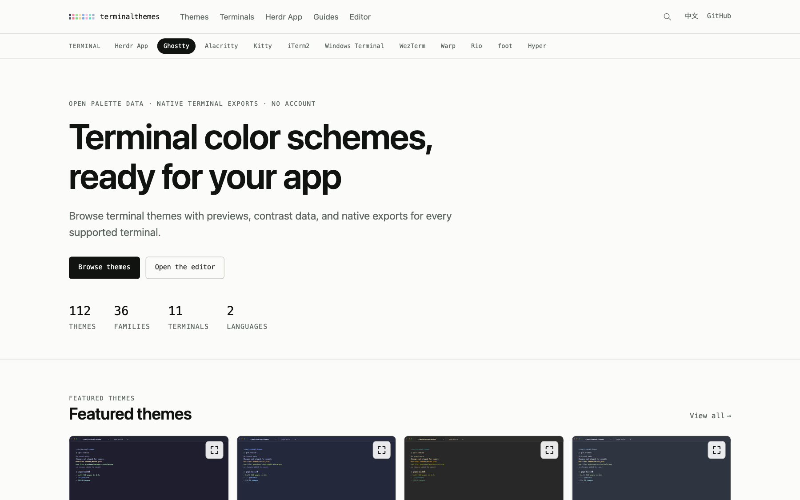
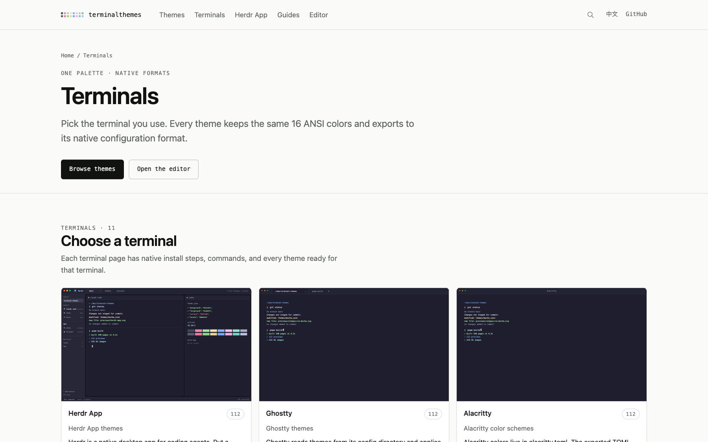
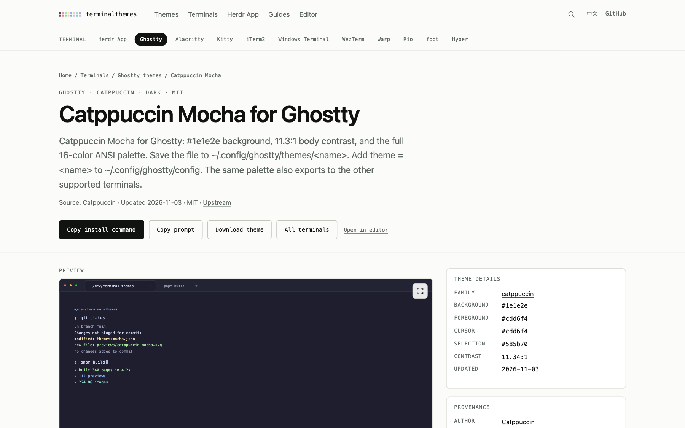
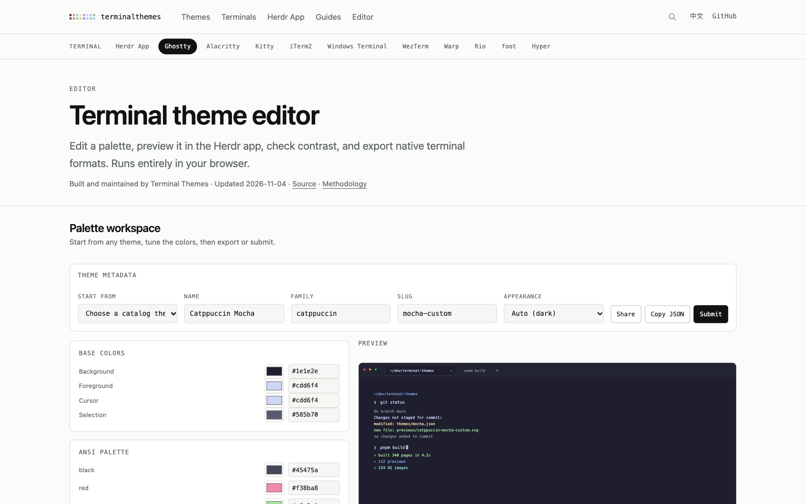

<div align="center">

# Terminal Themes

### One palette. Every terminal you use.

Browse terminal color schemes with live previews, contrast data, native exports, and terminal-specific install pages.

[](https://terminalthemes.iwwi.app)
[](https://github.com/ZxBing0066/terminal-themes/actions/workflows/ci.yml)
[](LICENSE)
[](https://terminalthemes.iwwi.app/themes/)
[](https://terminalthemes.iwwi.app/terminals/)

**[Browse themes](https://terminalthemes.iwwi.app/themes/)** · **[Open the editor](https://terminalthemes.iwwi.app/editor/)** · **[Terminals](https://terminalthemes.iwwi.app/terminals/)** · **[中文](https://terminalthemes.iwwi.app/zh/)**

<a href="https://terminalthemes.iwwi.app">
  
</a>

</div>

## Why this exists

Terminal palettes are easy to find and annoying to install. Every app wants a different file, a different path, and a different color model. This project keeps one canonical palette and generates the native file for each terminal at build time.

- **112 themes, 36 families** from the terminal-colors ecosystem, each with source and license.
- **Eleven native targets** — Herdr App, Ghostty, Alacritty, Kitty, iTerm2, Windows Terminal, WezTerm, Warp, Rio, foot, and Hyper.
- **Terminal-specific pages** at `/{terminal}/themes/{family}/{slug}/`, with install steps, commands, FAQ, and `HowTo` schema.
- **One editor, every format** — tune 16 ANSI colors plus background, foreground, cursor, and selection, then preview and export.
- **Static by design** — no server, no accounts, no cookies; the whole catalog is built as static HTML and JSON.
- **Open source** — one JSON file is all it takes to contribute a theme.

## Product tour

| Terminals | Theme pages |
| --- | --- |
| [](https://terminalthemes.iwwi.app/terminals/) | [](https://terminalthemes.iwwi.app/ghostty/themes/catppuccin/mocha/) |
| Pick the app you use; every page keeps that choice. | Install steps, preview, contrast, palette, and exports for one theme. |

[](https://terminalthemes.iwwi.app/editor/)

The editor runs entirely in the browser. Start from any catalog theme, edit the palette, compare contrast, share a URL, copy JSON, or export every native format.

## Supported terminals

| Target | Native format | Install location |
| --- | --- | --- |
| **Herdr App** | JSON theme | `~/.config/herdr-app/themes/` |
| **Ghostty** | Ghostty config fragment | `~/.config/ghostty/themes/` |
| **Alacritty** | TOML color block | `~/.config/alacritty/alacritty.toml` |
| **Kitty** | Kitty config fragment | `~/.config/kitty/` |
| **iTerm2** | `.itermcolors` plist | Import through iTerm2 settings |
| **Windows Terminal** | JSON color scheme | Windows Terminal `settings.json` |
| **WezTerm** | Lua color table | `~/.config/wezterm/colors/` |
| **Warp** | YAML theme | `~/.warp/themes/` |
| **Rio** | TOML theme | `~/.config/rio/themes/` |
| **foot** | INI color section | `~/.config/foot/themes/` |
| **Hyper** | JavaScript local plugin | `~/.hyper_plugins/local/` |

Each theme stores:

- 16 ANSI colors: normal and bright variants of black, red, green, yellow, blue, magenta, cyan, and white
- background, foreground, cursor, cursor text, selection background, and selection foreground
- upstream source, author, license, appearance, and timestamps

Ports, previews, contrast ratios, and OG images are generated at build time and are never committed as duplicate data.

## Quick start

1. **Browse** a theme at [terminalthemes.iwwi.app/themes](https://terminalthemes.iwwi.app/themes/).
2. **Pick your terminal** from the terminal bar.
3. **Copy the install command** or download the native file.
4. **Or let an agent install it** — every theme page includes a copy-ready prompt with the install page, file, steps, and safety constraints.

No account is required. Theme pages expose stable canonical URLs, JSON endpoints, and `llms.txt` for crawlers and generative search.

## Contributing a theme

One theme is one JSON file at `themes/<family>/<slug>.json`. You do not need to modify the site or run a build.

1. Open the [editor](https://terminalthemes.iwwi.app/editor/).
2. Start from a catalog theme or adjust the default palette.
3. Set `family`, `slug`, and `name`.
4. Press **Submit** and paste the JSON into the prefilled GitHub page.

CI validates the schema, path/id consistency, duplicate palettes in OKLab, source and license metadata, all serializers, and the full static build. See [`CONTRIBUTING.md`](CONTRIBUTING.md) for the manual path and the complete schema.

## Development

```sh
pnpm install
pnpm dev            # local dev server
pnpm build          # static build + Pagefind index
pnpm preview        # serve dist/
pnpm test           # Vitest: color math, serializers, catalog checks
pnpm astro check    # TypeScript check
pnpm import:themes  # refresh palette data from the reference catalog
```

## Project structure

```text
themes/<family>/family.json
themes/<family>/<slug>.json       one canonical palette per file
src/lib/                          schema, color math, data loader, ports, previews, SEO
src/components/                   Astro pages, terminal bar, and the Preact editor
src/content/                      guides in en/ and zh/
src/pages/                        catch-all routes and static endpoints
scripts/                          importer
docs/adr/                         design decisions
docs/screenshots/                 README screenshots
```

The site is built with Astro and Preact. Theme previews and OG images are generated as SVG at build time; the editor reuses the same renderers in the browser.

## Licensing

- Code: MIT — [`LICENSE`](LICENSE)
- Guides and site prose: CC BY 4.0 — [`LICENSE-CONTENT`](LICENSE-CONTENT)
- Theme records keep their upstream license and attribution. The site does not host upstream theme files, screenshots, or copied prose.

The bundled JetBrains Mono font is licensed under the SIL Open Font License; see [`public/fonts/OFL.txt`](public/fonts/OFL.txt).
